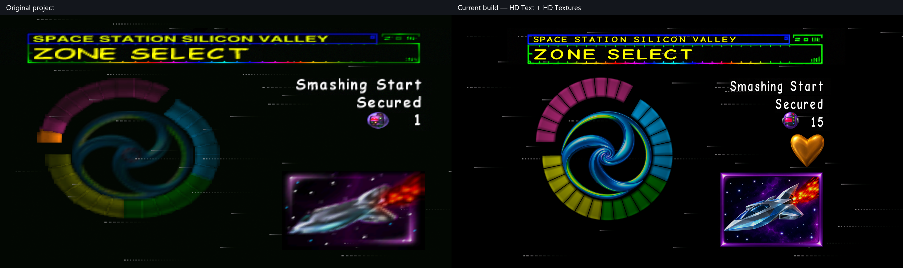
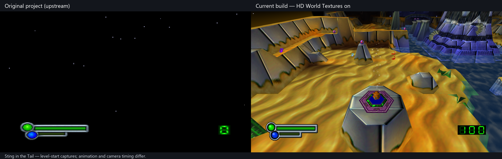
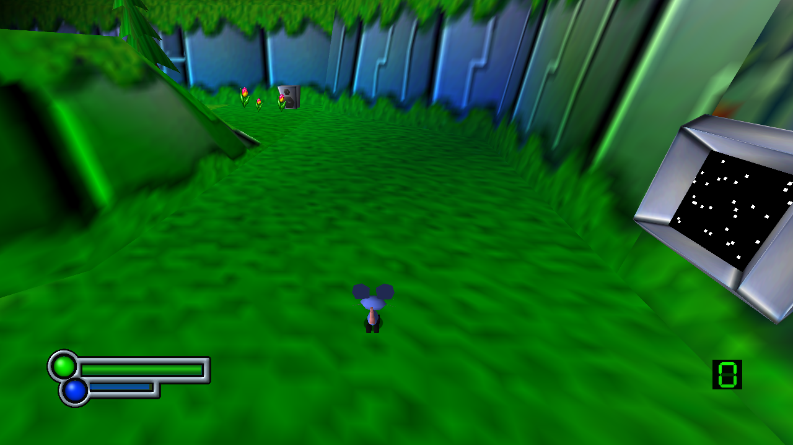
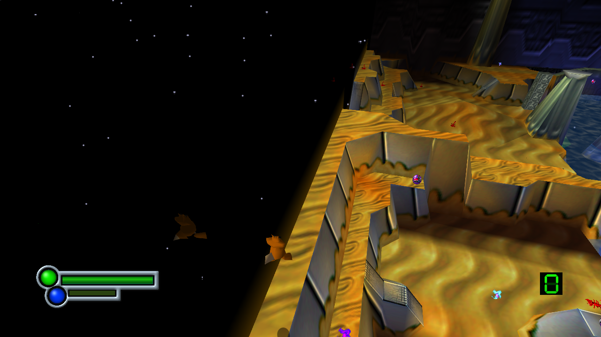
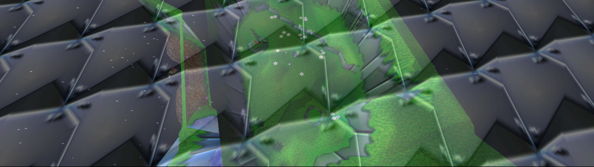
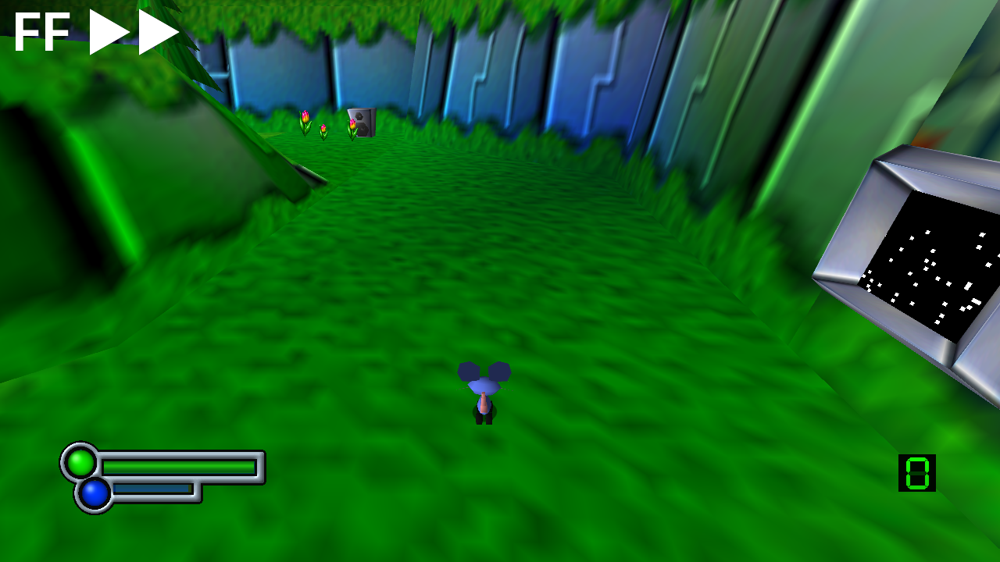
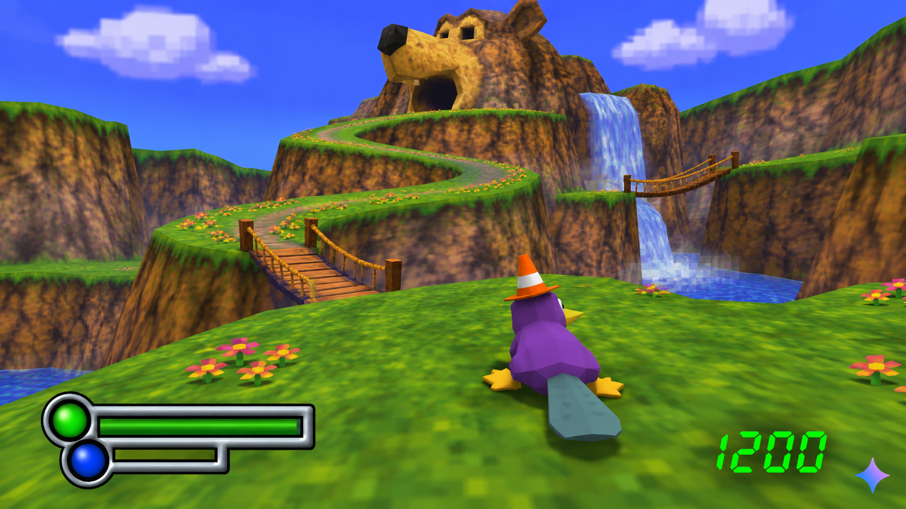
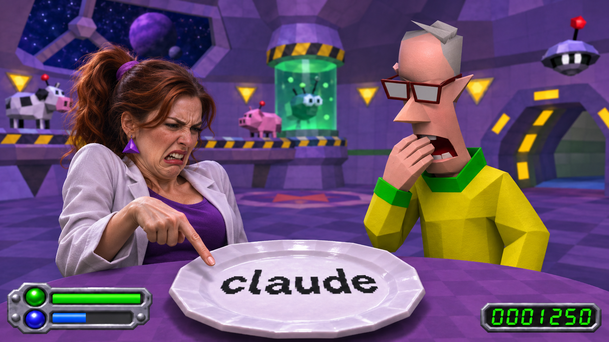

# Space Station Silicon Valley: Recompiled

## Purpose of Project

This is a fork of Cellenseres's Space Station Silicon Valley Recompilation Project. This was done to fix the scaling of the appropriate graphics and fix the intro bugs among other things. Credit to Cellenseres for the original project.

## Screenshot comparisons

Original project on the **left**, this build on the **right**. Both use 16:9 Expand mode; HD Text and the optional HD texture pack are enabled in the current build. Captures are from the same scenes, with animation and camera timing differences. [Capture details](docs/screenshots/CAPTURE-NOTES.txt).

### Copyright screen

### DMA scene in widescreen

### Title screen

### Bank select

### Zone select

### Gameplay and HUD

### In-game objective text

### Sting in the Tail

The original project renders a black world in this scene; the current build renders the level. These are separate captures from the same level, not identical animation frames.

### Television monitor static

### Nearby animal reflections

### Extended introductory glass

### Fast Forward

### Wait a minute, this isn't in the game... Begone with your Nonsense!

Is that even a real Gemini logo...?

## Changelog

### 4 November 2026 — v2026.11.04

- Added **Fast Forward** with Disabled / 2X / 4X / 8X / 16X speeds, defaulting to 4X. Tab is the default keyboard binding; the controller binding is initially empty.
- Added Held (default) and Toggle activation, with safeguards to turn toggle mode off after a two-second hold or excessive repeated presses. Fast forward works in gameplay, menus and cutscenes, keeps accelerated audio playing, and displays a white FF indicator at the top left. Higher speeds depend on system performance.
- Corrected television static to use clearer, spaced white dots and native-rate animation, with more consistent visibility at different viewing distances.
- Restored the glass dome's reflection visibility checks and limited animal reflections to nearby animals. Reflections fade between four and five terrain tiles, reaching half visibility at 4.5 tiles.
- Extended the distance at which animals retain their proper models, reducing the coloured stand-ins seen at a distance.
- Fixed the temporary black rectangle over the title background when skipping startup screens quickly.
- Stabilised flower and other scenery sprite interpolation as objects enter view, and corrected the clipped edge of HD flowers.
- Extended the introductory glass pattern across widescreen and ultrawide views in both glass-breaking sequences, preserving the original breakable panes and shattering effects.
- Removed Herobrine.

### 3 November 2026 — v2026.11.03

- Added Herobrine.
- Added **Mirror Mode (Experimental)** in the **General** tab, with readable HUD/text and automatic left/right movement and camera reversal.
- Added `Mirror.tex` rules for world textures that need readable lettering in Mirror Mode.
- Restored animated static on animal-preview television monitors.
- Restored animal reflections on the glass dome.
- Restored motion-blur trails in the animal stats screen, including trails following the HD text.
- Restored intermittent television interference in the menus.
- Kept the animal stats foreground at 4:3 proportions, expanding the background up to 16:9 with black sides on wider displays.
- Renamed the optional artwork pack to **Scotts Somewhat Ok Texture Pack**.
- Removed Herobrine.

### Current version — 2 November 2026

- Fixed the blank world in **Sting in the Tail**: dynamic tails and chains now use a separate matrix buffer instead of overwriting the camera and projection matrices.
- Expanded the opaque display-list buffer to prevent dense scenes from overwriting neighbouring graphics data, including the overflow found in level 16.
- Fixed plants and other scenery disappearing in crowded scenes when animal rendering exhausted the shared matrix pool.
- Added **HD World Textures**, enabled by default and controlled separately from HD Text and HD Textures.
- Added HD world sprites, including plants, flowers, butterflies, collectibles and effects, plus HD sheep, jumping-sheep and dog tutorial signs with their mipmapped variants.
- Preserved native sprite placement, animation frames and paired colour/opacity textures.
- Added `--rom "path/to/file.z64"` to load a validated ROM from another location without installing a copy into `assets/`.
- Import the original version's save into `saves/` only when no portable save data exists. Keep the original file and preserve existing saves.

### Previous version — 1 November 2026

Significant changes from the original Cellenseres repository.

#### Launching, files and window behaviour

- Removed the launcher front screen so the game starts directly.
- ROM loads from `assets/data.z64` beside the executable.
- If the ROM is missing, a file picker opens. Valid ROMs are copied into place; invalid files produce an error and close the game.
- Save data always lives in `saves/` beside the executable.
- Windowed mode starts at approximately 75% of the screen.
- Added live FPS to the window/taskbar title.
- Enabled Alt+Enter fullscreen switching.
- Kept settings accessible through Escape.
- Changed the settings GUI font to Inter.

#### Graphics and aspect ratios

- Fixed Dan's floating hair and Evo's detached visor.
- Extended the DMA scene's white background to cover widescreen.
- Made the TV report consistently 4:3 with black side bars.
- Fixed its final background slide so it enters at widescreen size without snapping wider afterward.
- Kept the title logo, spaceship and "Press Start" at their original proportions while allowing the background to stretch.
- Matched the demo's "Press Start" size and position to the title screen.
- Corrected copyright, bank select, zone select and pause-menu foreground scaling.
- Preserved the shrinking-tile title transition with consistent foreground scaling.
- Corrected stretched world sprites, including flowers and collectibles.
- Fixed rendering problems at extreme window widths.
- Added adaptive HUD placement for ultrawide screens.
- Made expanded layouts respect the selected aspect-ratio mode.

#### Pause screen and cutscenes

- Fixed the corrupted pause-menu gameplay preview.
- Preserved the preview's aspect ratio with black bars where necessary.
- Adjusted the pause/unpause animation to reduce aspect-ratio jumps.
- Added Start/Enter skipping to the new-game intro, with a transition that holds black until the dog is visible.
- Allowed startup logos and the TV report to be skipped even with a fresh save.

#### HD text and textures

- Added **HD Text**, enabled by default, with an option to restore the original lettering.
- Replaced in-game bitmap lettering with sharper text and adjusted spacing, sizing and baselines.
- Replaced menu header lettering with live HD text over a textless frame.
- Added **HD Textures** (previously HD Hud), enabled by default.
- Created clearer health and energy bars with concentric lights and consistent silver shading.
- Added HD green LCD digits with visible inactive segments.
- Removed the separate "2D Sprite Upscaling" option and permanently selected Upscaled.

#### Optional texture pack

- Added an HD title logo and an expanded title background: show the centre at 16:9, reveal more of the panorama up to 32:9, and stretch beyond that width.
- Rebuilt the copyright screen with sharp lettering over a separate HD background, using the same ultrawide panorama rules.
- Added HD bank and zone select artwork, including circular progress rings, spiral centres, collectible icons, trophies and all 32 level thumbnails.
- Added an HD SV television test card while preserving its transition animation.
- Put the optional assets in `Textures/` beside the executable. The settings heading reads `Textures/name.txt`, falling back to “Textures” when the name is absent.
- Hide the texture-pack heading and HD settings when the texture folder is absent.
- Keep the menu's top caption sharp when HD Textures is enabled, even if HD Text is disabled.
- Preserve original artwork when HD settings are off, including after changing settings during transitions.

#### Stability and credits

- Added detailed diagnostics for picture stalls.
- Expanded graphics command buffers to prevent widescreen subtitles from overwriting neighbouring graphics data.
- Fixed a graphics-frame counter underflow that could permanently freeze rendering during level transitions.
- Added smooth interpolation to the scrolling credits text.

[Separate changelog file](CHANGELOG.md).

## Running

Supply your own supported Space Station Silicon Valley (USA) 1.0 big-endian `.z64` ROM. No ROM or personal saves are included in this repository.

Extract the Windows release and run `SSSVRecompiled.exe`. If `assets/data.z64` is missing, select your ROM in the file picker; the game validates it and installs it there. Saves are stored in `saves/` beside the executable. If no portable save data exists, the original version's save is copied from its old per-user location; existing saves and the original file are preserved. You can also launch with `--rom "path/to/file.z64"` to use a ROM elsewhere without copying it.

- **Escape:** settings.
- **Alt+Enter:** switch fullscreen/windowed.
- **Start/Enter during the new-game intro:** skip with a transition into gameplay.
- **HD Text**, **HD Textures** and **HD World Textures** are enabled by default and can be disabled independently. Optional artwork lives in `Textures/`; removing that folder hides the HD settings. The pack heading comes from `Textures/name.txt`.

## Windows, Linux and macOS builds

Use **Actions > Platform release builds > Run workflow** for Windows x64, Linux x64, Mac Apple Silicon and Mac Intel packages. These builds apply this fork's dependency patches and include HD assets and licenses. No ROM is uploaded or packaged. [Platform build instructions](docs/PLATFORM-BUILDS.md).

## Building this version

1. Clone this repository and initialize its dependencies with `git submodule update --init --recursive`.
2. Run `python tools/apply_dependency_patches.py` to apply this fork's runtime and renderer changes. The script checks all patches before applying and supports already-applied patches.
3. Follow the toolchain/build instructions in [the upstream README](README.upstream.md) and `.github/workflows/validate.yml`. For ROM-free builds, first run `python tools/ci_release.py prepare` to restore the checked generated C source. Regenerating that source requires your supported ROM locally as `sssv.us.z64`; it is never committed.

The dependency patch manifest records the exact upstream revisions. The patches include all local changes to N64ModernRuntime, RecompFrontend, RT64 and Plume, so a fresh clone does not depend on unpublished submodule commits.

## Upstream and credits

Original project: [Cellenseres/SSSV_Recomp](https://github.com/Cellenseres/SSSV_Recomp), based on commit `a4dbfe40e205bd804c76db62227e94f6d5858a9b`.

Built on [N64: Recompiled](https://github.com/N64Recomp/N64Recomp), [RT64](https://github.com/rt64/rt64), N64ModernRuntime, RecompFrontend, and the work of their contributors. Original upstream documentation and acknowledgements are preserved in [README.upstream.md](README.upstream.md). Dependencies retain their own copyright and license notices. Font licenses are included with their assets.

## AI Disclosure

I'm not going to pretend I didn't use AI, I used it. I used it a lot, if you've got a problem with that? Understandable. I'm not going to make any excuses for it.

OpenAI Codex deserves credit for the AI-assisted coding, debugging, and texture work on this fork. Claude wasn't used at all. Any files claiming "Claude was here" are clearly an elaborate alibi.

I am eagerly awaiting a true human-made version of Space Station Silicon Valley recomp myself.

All credit goes to Wiseguy and Dario plus the rest of his team for even making this possible in the first place even though I know they frown upon projects like this.

Claude wasn’t even used in this project, allegedly. 
