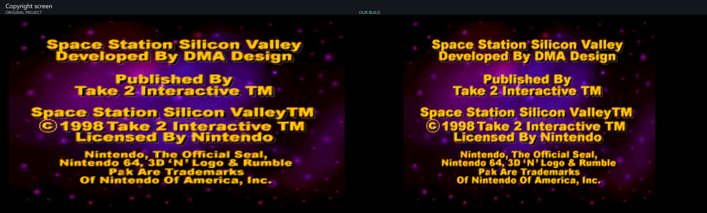
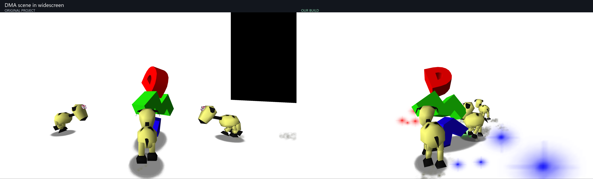
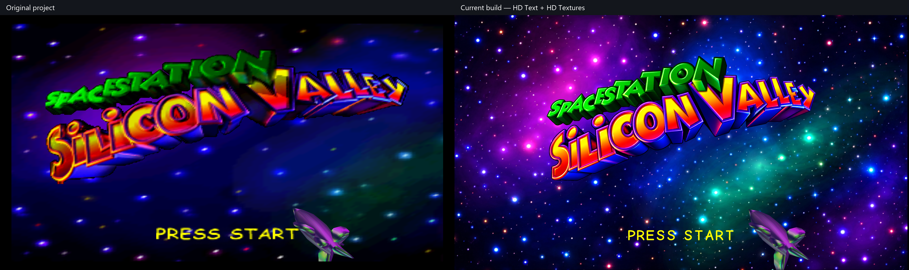
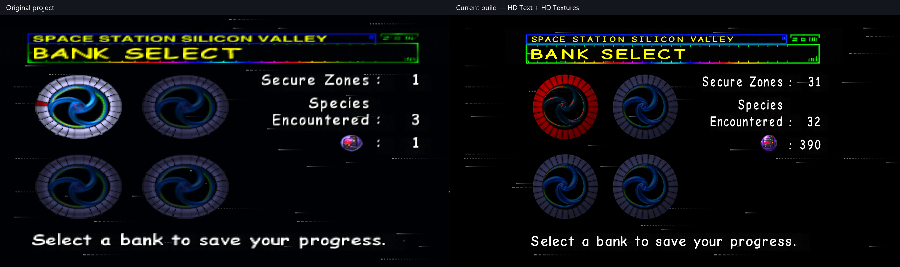
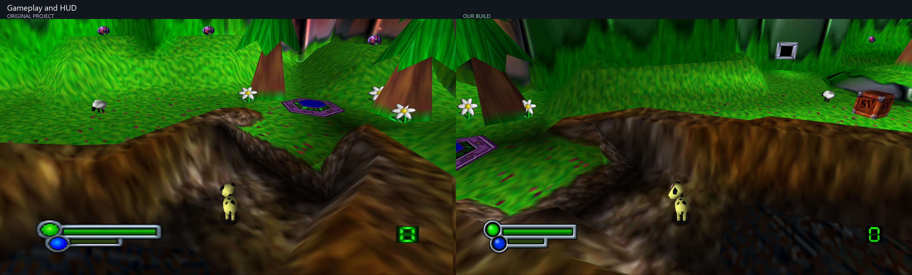
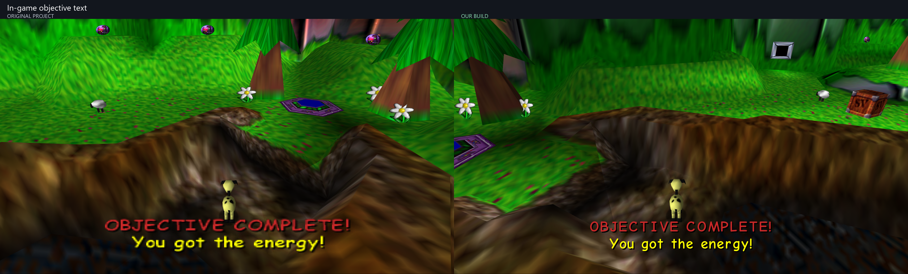

# Space Station Silicon Valley: Recompiled

## Purpose of Project

This is a fork of Cellenseres's currently abandonned Space Station Silicon Valley Recompilation Project. This was done to fix the scaling of the appropriate graphics and fix the intro bugs among other things. Credit to Cellenseres for the original project.

## AI Disclosure

I'm not going to pretend I didn't use AI, I used it. I used it a lot, if you've got a problem with that? I'm fine with it. I too am eagerly awaiting a true human-made version of Space Station Silicon Valley recomp and all credit goes to Wiseguy and Dario plus the rest of his team for even making this possible in the first place even though I know they frown upon projects like this.

## Screenshot comparisons

Original project on the **left**, this build on the **right**. Both use 16:9 Expand mode; HD Text and HD Hud are enabled in this build. Captures are from the same scenes, with animation and camera timing differences. [Capture details](docs/screenshots/CAPTURE-NOTES.txt).

### Copyright screen

### DMA scene in widescreen

### Title screen

### File select

### Gameplay and HUD

### In-game objective text

## Changelog

### Current version - 31 October 2026

Significant changes from the original Cellenseres repository.

#### Launching, files and window behaviour

- Removed the launcher front screen so the game starts directly.
- ROM loads from `assets/data.z64` beside the executable.
- If the ROM is missing, a file picker opens. Valid ROMs are copied into place; invalid files produce an error and close the game.
- Save data always lives in `saves/` beside the executable.
- Windowed mode starts at approximately 75% of the screen.
- Added live FPS to the window/taskbar title.
- Enabled Alt+Enter fullscreen switching.
- Kept settings accessible through Escape.
- Changed the settings GUI font to Inter.

#### Graphics and aspect ratios

- Fixed Dan's floating hair and Evo's detached visor.
- Extended the DMA scene's white background to cover widescreen.
- Made the TV report consistently 4:3 with black side bars.
- Fixed its final background slide so it enters at widescreen size without snapping wider afterward.
- Kept the title logo, spaceship and "Press Start" at their original proportions while allowing the background to stretch.
- Matched the demo's "Press Start" size and position to the title screen.
- Corrected copyright, bank select, zone select and pause-menu foreground scaling.
- Preserved the shrinking-tile title transition with consistent foreground scaling.
- Corrected stretched world sprites, including flowers and collectibles.
- Fixed rendering problems at extreme window widths.
- Added adaptive HUD placement for ultrawide screens.
- Made expanded layouts respect the selected aspect-ratio mode.

#### Pause screen and cutscenes

- Fixed the corrupted pause-menu gameplay preview.
- Preserved the preview's aspect ratio with black bars where necessary.
- Adjusted the pause/unpause animation to reduce aspect-ratio jumps.
- Added Start/Enter skipping to the new-game intro, with a transition that holds black until the dog is visible.
- Allowed startup logos and the TV report to be skipped even with a fresh save.

#### HD text and HUD

- Added **HD Text**, enabled by default, with an option to restore the original lettering.
- Replaced in-game bitmap lettering with sharper text and adjusted spacing, sizing and baselines.
- Replaced menu header lettering with live HD text over a textless frame.
- Added **HD Hud**, enabled by default.
- Created clearer health and energy bars with concentric lights and consistent silver shading.
- Added HD green LCD digits with visible inactive segments.
- Removed the separate "2D Sprite Upscaling" option and permanently selected Upscaled.

#### Stability and credits

- Added detailed diagnostics for picture stalls.
- Expanded graphics command buffers to prevent widescreen subtitles from overwriting neighbouring graphics data.
- Fixed a graphics-frame counter underflow that could permanently freeze rendering during level transitions.
- Added smooth interpolation to the scrolling credits text.

[Separate changelog file](CHANGELOG.md).

## Running

Supply your own supported Space Station Silicon Valley (USA) 1.0 big-endian `.z64` ROM. No ROM or personal saves are included in this repository.

Extract the Windows release and run `SSSVRecompiled.exe`. If `assets/data.z64` is missing, select your ROM in the file picker; the game validates it and installs it there. Saves are stored in `saves/` beside the executable.

- **Escape:** settings.
- **Alt+Enter:** switch fullscreen/windowed.
- **Start/Enter during the new-game intro:** skip with a transition into gameplay.
- **HD Text** and **HD Hud** are enabled by default and can be disabled independently.

## Building this version

1. Clone this repository and initialize its dependencies with `git submodule update --init --recursive`.
2. Run `python tools/apply_dependency_patches.py` to apply this fork's runtime and renderer changes. The script checks all patches before applying and supports already-applied patches.
3. Follow the toolchain/build instructions in [the upstream README](README.upstream.md) and `.github/workflows/validate.yml`. Supply the supported ROM locally as `sssv.us.z64`; it is required for recompilation and is never committed.

The dependency patch manifest records the exact upstream revisions. The patches include all local changes to N64ModernRuntime, RecompFrontend, RT64 and Plume, so a fresh clone does not depend on unpublished submodule commits.

## Upstream and credits

Original project: [Cellenseres/SSSV_Recomp](https://github.com/Cellenseres/SSSV_Recomp), based on commit `a4dbfe40e205bd804c76db62227e94f6d5858a9b`.

Built on [N64: Recompiled](https://github.com/N64Recomp/N64Recomp), [RT64](https://github.com/rt64/rt64), N64ModernRuntime, RecompFrontend, and the work of their contributors. Original upstream documentation and acknowledgements are preserved in [README.upstream.md](README.upstream.md). Dependencies retain their own copyright and license notices. Font licenses are included with their assets.

This repository is private for now. Because GitHub does not allow private forks of public repositories, it is maintained as an independent private repository preserving the original Git history.
